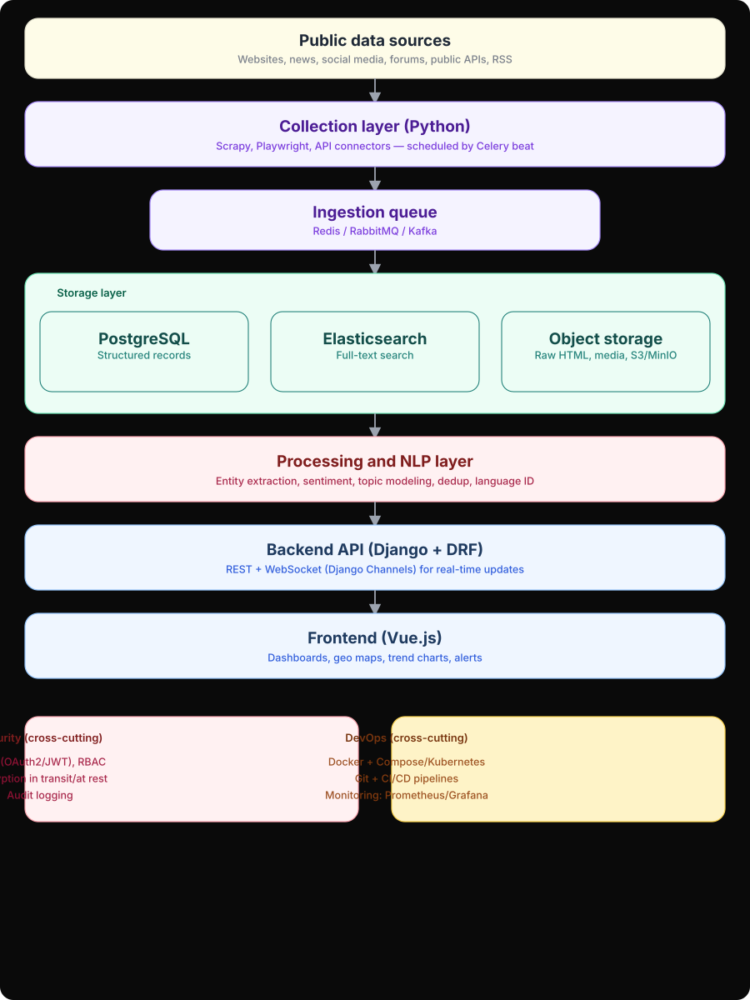

# Architecture — Quantsmind OSINT Intelligence Platform

> **Authoritative HLD:** This document follows the approved high-level design diagram exactly — 7 sequential layers (top→bottom) plus 2 cross-cutting concerns. See `docs/high-level-design.md` and `docs/diagrams/high-level-design.svg` (dark background, faithful to the approved image) / `docs/diagrams/high-level-design.mmd` (Mermaid).

## 0. High-Level Design (as approved)



**Mermaid source:** `docs/diagrams/high-level-design.mmd` — renders on GitHub and https://mermaid.live

```mermaid
flowchart TD
    A[Public data sources<br/><sub>Websites, news, social media, forums, public APIs, RSS</sub>]
    B[Collection layer (Python)<br/><sub>Scrapy, Playwright, API connectors — scheduled by Celery beat</sub>]
    C[Ingestion queue<br/><sub>Redis / RabbitMQ / Kafka</sub>]
    D{{Storage layer}} --> D1[(PostgreSQL<br/><sub>Structured records</sub>)] & D2[(Elasticsearch<br/><sub>Full-text search</sub>)] & D3[(Object storage<br/><sub>Raw HTML, media, S3/MinIO</sub>)]
    E[Processing and NLP layer<br/><sub>Entity extraction, sentiment, topic modeling, dedup, language ID</sub>]
    F[Backend API (Django + DRF)<br/><sub>REST + WebSocket (Django Channels) for real-time updates</sub>]
    G[Frontend (Vue.js)<br/><sub>Dashboards, geo maps, trend charts, alerts</sub>]
    A --> B --> C --> D --> E --> F --> G
```

## 1. Layers (verbatim from diagram, top → bottom)

| # | Diagram box | Purpose | Repo mapping |
|---|-------------|---------|--------------|
| 1 | **Public data sources**<br/>`Websites, news, social media, forums, public APIs, RSS` | Public-only inputs | `sources.Source` (`backend/sources/models.py:1`) — seed examples: Reuters/BBC RSS, GDELT, quotes.toscrape |
| 2 | **Collection layer (Python)**<br/>`Scrapy, Playwright, API connectors — scheduled by Celery beat` | Scheduled + on-demand scraping/API polling | `collectors/rss_collector.py:1` (feedparser), `collectors/scrapy_collector.py:1` (Scrapy+BS4), `collectors/news_api_collector.py:1` (REST), `collectors/policies.py:1` (`PolicyEnforcer`: robots.txt + rate_limit_rps + allowed_domains + block_auth/paywall), `collectors/tasks.py:1` (`poll_source`, `poll_all_sources`), Beat schedule `backend/config/celery.py:1` (15m poll, 2m enrich) |
| 3 | **Ingestion queue**<br/>`Redis / RabbitMQ / Kafka` | Decouples collectors from storage, absorbs bursts, retries | Primary: `redis:7` (`docker-compose.yml:17`), Celery broker `CELERY_BROKER_URL` (`backend/config/settings.py:104`). Pluggable: `rabbitmq`/`kafka` profiles in `docker-compose.yml:17` (swap `CELERY_BROKER_URL` / `QUEUE_BACKEND`); dead-letter + exponential backoff via Celery |
| 4 | **Storage layer** | Durable persistence by access pattern — 3 sub-boxes | **PostgreSQL** structured records (`backend/ingestion/models.py:1` `CollectedDocument`+`RawArtifact`), **Elasticsearch** full-text monthly `osint-documents-YYYY.MM` (`backend/processing/search.py:1`), **Object storage** raw HTML/media S3/MinIO (`backend/config/settings.py:109` + `minio` `docker-compose.yml:39`) |
| 5 | **Processing and NLP layer**<br/>`Entity extraction, sentiment, topic modeling, dedup, language ID` | Enrich & dedup | `backend/processing/nlp.py:1` (`extract_entities` spaCy, `analyze_sentiment`, `detect_language`, `extract_topics` BERTopic/keyword fallback, dedup sha256), `backend/processing/tasks.py:1` (`enrich_document`, `enrich_pending`) — Transformers/spaCy, language detection fastText/langdetect |
| 6 | **Backend API (Django + DRF)**<br/>`REST + WebSocket (Django Channels) for real-time updates` | Business logic, auth, live push, OpenAPI | Django+DRF (`backend/config/urls.py:1`, `backend/config/settings.py:79`), Channels (`backend/config/asgi.py:1`, `backend/alerts/consumers.py:1` `AlertConsumer`, `backend/alerts/routing.py:1` `ws/alerts/`), `drf-spectacular` Swagger at `/api/docs/` |
| 7 | **Frontend (Vue.js)**<br/>`Dashboards, geo maps, trend charts, alerts` | Analyst UX | Vue 3 + Pinia + Router (`frontend/src/router.js:1`), ECharts (`frontend/src/views/Dashboard.vue:1`), Leaflet/Mapbox (`frontend/src/views/MapView.vue:1`), search/filters (`frontend/src/views/SearchView.vue:1`), alerts/watchlists (`frontend/src/views/AlertsView.vue:1` + WS) |

### Cross-cutting (diagram bottom — two boxes side-by-side, apply to every layer)

| Box (verbatim) | Covers | Implementation |
|----------------|--------|----------------|
| **Security (cross-cutting)**<br/>`Auth (OAuth2/JWT), RBAC` `Encryption in transit/at rest` `Audit logging` | Auth, authorization, crypto, audit | JWT SimpleJWT (`backend/config/settings.py:90` short 15m access + refresh rotation), RBAC `backend/accounts/models.py:1` `Role admin/analyst/viewer` + `backend/accounts/permissions.py:1`, TLS `SECURE_*` (`backend/config/settings.py:127`), encryption at rest (PG volume/S3 SSE), secrets Vault/AWS Secrets Manager + `k8s/secret.example.yaml:1`, audit `backend/audit/middleware.py:1`→`backend/audit/models.py:1` `AuditLog` |
| **DevOps (cross-cutting)**<br/>`Docker + Compose/Kubernetes` `Git + CI/CD pipelines` `Monitoring: Prometheus/Grafana` | Build, deploy, observe | `docker-compose.yml:1` (dev), `k8s/*.yaml` (prod), Git + `.github/workflows/ci.yml:1` (lint/test/build/Trivy scan), `devops/prometheus.yml:1` + Grafana `docker-compose.yml:123` |

## 2. Data flow (arrows in diagram)

```
Public data sources
  ↓  (Celery Beat every 15m → poll_all_sources → poll_source per Source; on-demand via POST /api/sources/{id}/trigger/)
Collection layer — PolicyEnforcer checks respects_robots, rate_limit_rps, allowed_domains, block_auth/paywall
  ↓  push raw payloads
Ingestion queue — Redis (Celery task queue); RabbitMQ/Kafka via QUEUE_BACKEND swap
  ↓  workers: dedup sha256+canonical_url, write raw to S3 (RawArtifact), metadata to PostgreSQL (status=raw)
Storage layer — PostgreSQL + S3 are sinks; ES indexed after enrichment
  ↓  enrich_pending (every 2m) picks status=raw
Processing and NLP layer — NER/sentiment/topic/lang + geo, write Enrichment, index to Elasticsearch (status=enriched→indexed), dispatch check_alerts_for_document
  ↓
Backend API — serves search/filter/aggregation from ES+PG; pushes Alert via Channels group user_{id} to ws/alerts/
  ↓  REST + WebSocket
Frontend — Vue dashboards poll /api/documents/?search=&status=&language= & /api/processing/search/?q= & /api/processing/trends/ & /api/processing/geo/, subscribes to alerts WS
```

Security & DevOps are **orthogonal** — not in the vertical chain, but enforced at every layer (auth at API/gateway, TLS at ingress, encryption for PG/S3, audit at middleware, CI gate on every push, Prometheus metrics from `backend:8000`).

## 3. Non-functional requirements (from brief, mapped to diagram)

- **Scalability:** Horizontal collectors/workers (Celery concurrency), storage sized for sustained high-volume ingestion, partitioned ES monthly indices with ILM.
- **Reliability:** Retry/backoff, dead-letter queue, healthchecks (`docker-compose.yml:12`, `22`, `51`), Beat reschedules failed polls.
- **Security & compliance:** RBAC per role (analyst/admin/viewer), full audit trail, TLS in transit + encryption at rest, no public branch without review (branch protection on `main`).
- **Legal/ethical scraping:** Respect `robots.txt` + ToS + rate limits, never collect behind auth/paywalls, per-source `CollectionPolicy.jurisdiction` + configurable collection policies.
- **Auditability:** Every `CollectedDocument` traceable to `source.url` + `collected_at` + `content_html_s3_key` (S3 key).
- **Observability:** Prometheus metrics, structured logs, alerting on pipeline failures (Grafana dashboards, Loki/ELK for logs).

## 4. Suggested tech per layer (diagram → stack)

| Diagram layer | Suggested tech (brief) | Implemented |
|---------------|------------------------|-------------|
| Collection | Python, Scrapy, Playwright/Selenium, requests/httpx, Celery+Beat | `Scrapy`/`Playwright` connectors + `feedparser`/`httpx`/`requests` + Celery 5 + Beat |
| Queue | Redis or RabbitMQ (Kafka if very high) | Redis primary; compose profiles for RabbitMQ/Kafka |
| Storage | PostgreSQL, Elasticsearch/OpenSearch, S3/MinIO, optional Neo4j | PostgreSQL 16, ES 8.12, MinIO (S3), Neo4j optional via `NEO4J_URL` |
| Processing | spaCy / HF Transformers, BERTopic/LDA, fastText/langdetect | `spaCy en_core_web_sm` + `transformers` + `langdetect`/`fastText` path |
| Backend | Django+DRF, Django Channels | Django 5 + DRF 3.15 + Channels 4 + Daphne |
| Frontend | Vue 3 + Pinia, ECharts/Chart.js/D3, Leaflet/Mapbox GL | Vue 3 + Pinia + Router, ECharts, Leaflet |
| Security | OAuth2/JWT, RBAC, TLS, audit logs, Vault | SimpleJWT + RBAC + TLS headers + AuditLog + secrets pluggable |
| DevOps | Docker+Compose/K8s, Git+GitHub Actions, Prometheus+Grafana, ELK/Loki | Docker+Compose, K8s manifests, GitHub Actions CI, Prometheus+Grafana, ELK/Loki ready |

## 5. Repository layout

```
backend/        Django + DRF + Channels + Celery (accounts/sources/ingestion/processing/alerts/audit)
collectors/     RSS / Scrapy / News-API collectors + PolicyEnforcer + Celery tasks
frontend/       Vue 3 SPA (Pinia, Router, ECharts, Leaflet)
k8s/            Kubernetes manifests (backend/postgres/ingress/secret)
devops/         prometheus.yml, grafana provisioning
docs/           high-level-design.md, architecture.md, data-model.md, security-checklist.md, diagrams/
.github/        CI workflow (lint, test, build, Trivy)
docker-compose.yml  local dev stack (9 services)
```

## 6. References

- HLD source: `docs/high-level-design.md:1`
- Data model: `docs/data-model.md:1`
- Security checklist: `docs/security-checklist.md:1`
- Queue pluggability: `docker-compose.yml:17` (replace `redis` with `rabbitmq:3` or `kafka` and set `CELERY_BROKER_URL`)
